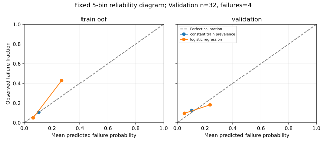

# Fixed Formal Logistic Baseline — 2026-11-28

## Executive Result

**固定基线的实现、一次性运行和结果审计 PASS；尚无可靠风险预测能力的证据。**

在 Validation（32 行、4 失败）上，Logistic AUROC **0.4375**、Brier **0.113291**、
Log Loss **0.426025**，未优于常数 Train 比例基线的 0.5000 / 0.109765 / 0.378734。
Logistic 的 AP 较高，但不是所有排序/概率指标都改善，且置信区间很宽。
固定阈值 0.5 下，两模型均未预测任何失败，Recall=0，Precision 因分母 0 为 undefined。
不修改参数、阈值、标签或样本来改变这一结果，不据此声称风险模型有效。

Run：`formal_logistic_20261128_ec170bf0`。
Gate：`FORMAL_LOGISTIC_BASELINE_PASS`，仅工程/实验执行层面。
Test 未打开、LightGBM 正式模型未拟合、未进入干预/策略实验，formal_dataset_ready=false。

## Authorization and Freeze Before Observation

用户在已提交候选方案后批准“好的，继续”，本轮实施并执行固定本地基线。
活动参数 `formal_logistic_baseline_v1.yaml` 与原候选完全相同，仅改变审批状态。
旧候选、数据准备清单和所有采集配置/结果不修改。

实现先完成 **50 项专项/兼容性测试**和真实快照预检；尚未观察正式模型指标时，
创建并推送实现 Commit **`03db88e`**。随后从干净已提交代码只调用一次正式 fit 入口。
清单 SHA-256：
`995c38fee060ac052117f902f6c6de028a7d68be2f8fe9028a874f3311d123d6`。

一轮实验包括 3 个 Train CV Logistic 拟合及 1 个全 Train 最终拟合，不是参数搜索。
fit_claim 保留；监督记录 fit_invocations=1、automatic_retries=0。没有观察 Val 后重跑或换模型。

## Data and Leakage Controls

仅使用先前已审核快照：
`runs/phase2_baseline_preparation/baseline_preparation_20261128_b841be51/qualified_snapshot_final_20261128/`。
快照 Manifest SHA-256：
`bd48e1b0b07d83574854e083a67226d47c79c8cbe8fd6cbc494fde76696c5e44`。
127 行有序 digest：
`18435bcbc8cc75d4d56220f75233fc78872d5cb5ef0e720fce9f2b51c419492c`。

拟合前重验原资格索引和 7204 个源 Artifact、主 outcome/Checkpoint lineage、Source 特征
重算及 provenance。Train 95（85 成功/10 失败、48 模板）；Val 32（28/4、16 模板）。
Train/Val 模板无交叉；19/7 重复不作为独立行，Train 历史 null 保留为删失而非补成 0。
这条历史缺失不假定随机无关，后续分析必须披露。

正类为 y_failure=1-y_continue；原 y_continue 不改写。X 只用原 18 个 allowlist 值，
任务/模板/Run/版本/故障分配/隐藏 truth/最终结果/未来成本均不作为特征。
常量识别、中位数、均值方差仅在 Train 或当前 CV 训练折拟合。Val 只 transform/predict。
固定类别词表，none 为参照，未知类别拒绝，不激活额外进展特征。

全 Train 删除 9 个常量后保留 9 个原始变化字段，类别展开后 **14 列、矩阵秩 9**。
这不是 14 个独立信号，也不是样本功效或 LightGBM 适用性的证明。

## Fixed Models and CV

- 常数基线：全 Train 失败率 **10/95=0.105263**；CV 每折用其训练折比例。
- Logistic：L2、C=0.1、lbfgs、max_iter=2000、class_weight=None、seed20261128。
  sklearn1.9 使用 l1_ratio=0 表达 L2，避免弃用参数，不改变正则含义。
- Train-only 3 折 StratifiedGroupKFold，template_id 分组、shuffle、seed20261128 固定。
- 阈值固定 0.5，无阈值选择、参数搜索、seed/折数重抽或后处理校准器拟合。
- 最终模型全 Train 拟合，8 次优化迭代收敛；只从本次拥有目录加载序列化模型，
  Val 预测与序列化前逐值一致。

| Fold | 训练 / 留出行 | 训练 / 留出失败 | 编码矩阵秩 |
| --- | --- | --- | --- |
| 1 | 63 / 32 | 6 / 4 | 9 |
| 2 | 64 / 31 | 7 / 3 | 9 |
| 3 | 63 / 32 | 7 / 3 | 7 |

每折两类均存在，无不可估计折。每行只有一次 OOF，预处理 fit_task_ids 与当前训练折
完全匹配，与留出折及 Val 不交叉。原模板边界、数据和参数均未修改。

## Actual Metrics

| 数据 | 模型 | AUROC | AUPRC（Average Precision） | Brier | Log Loss |
| --- | --- | --- | --- | --- | --- |
| Train OOF，95 行/10 失败 | 常数训练比例 | 0.462941 | 0.098802 | 0.094435 | 0.337868 |
| Train OOF | Logistic | 0.665882 | 0.536747 | 0.080368 | 0.304762 |
| Validation，32 行/4 失败 | 常数训练比例 | 0.500000 | 0.125000 | 0.109765 | 0.378734 |
| Validation | Logistic | 0.437500 | 0.352713 | 0.113291 | 0.426025 |

OOF 常数模型在各折使用不同训练比例，池化后不是全局同一分数，所以 AUROC 不必为 0.5。
Val 常数分数全为 10/95，其 AUROC 为 0.5，AP 为 Val 失败比例 4/32。

两模型在 OOF 和 Val 上均 predicted_failures=0，TP=FP=0；Precision 为 null（分母 0），
Recall=0（OOF 分母 10、Val 分母 4）。未将 undefined 写成有效 Precision=0。
Log Loss 采用预先明确的 [1e-15,1-1e-15] 裁剪规则。

## Template Bootstrap and Calibration

每个数据集 1000 次 template cluster bootstrap，seed20261128，模型共用相同抽样索引。
抽中模板保留其所有行及整簇重复次数，不逐行重采；不在 Bootstrap 内重拟合模型。
区间仅条件于本次固定预测，不包含训练过程不确定性，不作为因果收益区间。

| Logistic 指标 | Train OOF 95% 百分位区间 | Val 95% 百分位区间 |
| --- | --- | --- |
| AUROC | [0.355472, 0.971334] | [0.000000, 0.866667] |
| AP | [0.132826, 0.867669] | [0.031250, 0.699479] |
| Brier | [0.030983, 0.140153] | [0.029614, 0.213654] |
| Log Loss | [0.149572, 0.513287] | [0.163322, 0.751329] |

Train OOF 有 2/1000、Val 有 29/1000 重采样为单类，对应 AUROC/AP/无正类 Recall 为
undefined；原始文件保留逐指标有效/undefined 次数。Precision 全部 1000 次 undefined。
Val 只有 4 个失败类，不能根据高 AP 或少量点估计推断稳定收益。

可靠性图使用 5 个固定等宽箱，空箱为 null，未按 Val 重新选箱或拟合校准器。
SVG/PNG 原文件保留在 Run，Git 仅提交不含 Task ID/个体数据的聚合 SVG。
发布副本移除 Matplotlib 导出的行尾空格；规范化 XML 图形内容比较一致，原始 SVG 与
实验 Manifest 不修改。发布格式核验单列在 baseline_delivery_20261128_ec170bf0 审计目录。

## Tests and Independent Result Audit

最终专项及兼容性 **50 passed，0 failed，0 skipped**，1.41 秒，compileall/diff check 通过。
覆盖 Train/Val/Test 拟合隔离、Train-only 缺失/常量/标准化、正类方向、序列化、模板 OOF、
单类折、概率/标签输入校验、空分母、整簇/配对 Bootstrap、收据/快照及已有模型拒绝覆盖。
旧 Day 10 回归中的临时模型仅使用合成 Fixture，未用于本次正式预测。
本轮新增独立入口，不修改旧生产模块，未重复全仓测试。

独立审计不重新拟合：核验 **12 个 Run Artifact**、254 条预测（2 模型×127 行）、
全部 3 折身份及预处理均值/中位数、原快照及模型加载后预测一致性。
用成对正负概率比较独立重算 AUROC、按唯一阈值阶梯积分独立重算 AP，
另按公式重算 Brier/Log Loss，均与报告逐值匹配，不只重复调用同一指标函数。
检查所有 Bootstrap valid+undefined=1000，原 fit_claim 绑定唯一 Run。

## Environment, Resources and Integrity

训练环境未变：numpy2.5.5、scikit-learn1.9.1、scipy1.18.1、joblib1.6.0。
训练环境无绘图库，故在本次拥有目录建立独立 plot_env；通过 pip 下载 matplotlib 及
绘图依赖，安装日志和完整包版本另存。实际绘图 matplotlib3.11.2、numpy2.5.5。
绘图解释器只读取聚合分箱 JSON，训练和渲染均有禁止网络钩子；图像已本地检查。

实验运行单调耗时 **7.707 秒**，进程退出 0。原 UTC 为
2026-11-28T08:54:28.309542+00:00 至 08:54:36.016644+00:00（北京时间约 16:54）。
不修改系统时间。实验室 SSH、隧道、Qwen/API、GPU/vLLM/Docker 操作均为 0。
pip 绘图依赖下载与 GitHub Git Push 发生网络访问，与实验请求分开记录；不声称整轮零网络。

**42722 个历史文件、429 个既有跟踪文件** SHA-256 全部不变。准备快照和所有原始资格/
标签、旧 Val BLOCKED、claim、协议/预算/特征定义不修改，Test 结果未解析。
本次无进程/隧道需要清理，模型和图表本地只追加，不覆盖历史。

## Artifacts, Git and Remaining Work

正式模型/预测/指标/Bootstrap/图表：
`runs/phase2_formal_baseline/formal_logistic_20261128_ec170bf0/`。
原始审计：`runs/phase2_formal_baseline_audit/baseline_audit_20261128_ec170bf0/`。
保留预检、测试、唯一实际 argv/进程收据、独立结果核验、历史完整性和最终 Manifest。
审计 Manifest 覆盖研究证据；安装的 plot_env 目录作为工具环境另列，只收录安装日志和
版本表，不把第三方安装文件逐项计入研究产物。模型 joblib、个体预测和原始数据不上传。

实现 Commit `03db88e` 在正式拟合前已推送；本脱敏报告和聚合 SVG 按仓库规范追加交付。
实际运行参数绑定 configs/formal_logistic_baseline_v1.yaml，完整 argv 见本地审计。

下一步建议先离线审核误差模式、早期特征表达及数据覆盖限制，提出下一版研究方案。
现有结果不能区分样本量、特征、版本变化或模型容量的具体影响，不能先假定单一原因。
不据 Val 追调当前参数、不降低阈值凑 Recall、不打开 Test、不训练 LightGBM或追加采集。
任何特征/采样/模型/阈值变更须另行审核和版本化，当前负面结果保持原样。

## Status: PASS — execution and audit only

`FORMAL_LOGISTIC_BASELINE_PASS`；预测实用性 **NOT_ESTABLISHED**，Test 泛化未验证。
